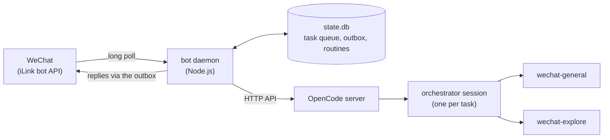

# wechat-opencode-bot

English | [中文](README_zh.md)

A bridge between WeChat and [OpenCode](https://opencode.ai). Each message you send the bot becomes a task: a daemon on your machine runs it in a new session on a local OpenCode server and sends the result back to the chat. It handles text, images, permission approvals, scheduled tasks, several bots and several projects.

## Architecture

### Components

| Component | Process / runtime | Role |
|---|---|---|
| WeChat, iLink bot API | Tencent's service at `ilinkai.weixin.qq.com` | Hands your messages to the daemon by long poll and delivers its replies |
| Bot daemon | `node dist/main.js --daemon`, Node.js | Routes messages, queues tasks, drives OpenCode over HTTP, sends the results |
| OpenCode server | `opencode serve` on `127.0.0.1:4096` | Runs the agent sessions and calls the models |
| Orchestrators | Primary agents `wechat-orchestrator` and `wechat-orchestrator-read` | Plan each task, delegate the work, write the reply |
| Subagents | `wechat-general` (can edit files) and `wechat-explore` (cannot) | Do the work: read code, run commands, edit files |
| `state.db` | SQLite through `node:sqlite`, in the data directory | Tasks, outbox, routines, per-chat settings |
| launchd | Two macOS user jobs, optional | Keep the server and the daemon running ([docs/DEPLOY.md](docs/DEPLOY.md)) |

### Task lifecycle

1. The daemon long-polls iLink and ignores anyone not in `WECHAT_ALLOWED_IDS`. Each message refreshes the chat's `context_token`, which every reply needs.
2. `y`/`n` answers a waiting permission ask and a `/` command gets a direct reply. Anything else becomes a task: the daemon downloads the first image, routes the text to a bot and a project, and stores the task in `state.db`. With tasks ahead it replies `⏳ 已排队：任务 #N（前面还有 X 个任务）` and an estimate.
3. The lane's worker takes the oldest queued task and opens a new OpenCode session at the project root, or in the chat's working directory. OpenCode loads that directory's `AGENTS.md` and `opencode.json`, whose rules take precedence over memory and recent tasks.
4. Sessions are never resumed, so the prompt carries the context: time, attachments, the bot's role, the project, the chat's memory and the last 8 tasks, with reply excerpts for the latest 2.
5. The orchestrator hands the work to `wechat-explore` or `wechat-general`, at most 3 at once and 6 per task. Permission asks go to WeChat, and a long task sends up to 4 progress notes.
6. The orchestrator ends its output with `<<<WECHAT_REPLY>>>`, `<<<WECHAT_MEMORY>>>` and `<<<WECHAT_SUMMARY>>>` sections. The daemon keeps the reply, adds up to 5 dated facts to memory and stores the one-line summary for later prompts.
7. The result goes to the outbox and out in 2048-character chunks, after the bot's reply prefix. A failure reads `⚠️ 任务 #N 失败：…`; a task cut off by a restart reads `⏹ 任务 #N 已中断…`.

### Routing

`bots.json` and `projects.json` in the data directory hold the bots and the projects. Both are written on first use and re-read for every message; after that they are yours to edit. The default bots are `chief` (default, no prefix), `research` (read-only, `研究：`), `eng` (`工程：`) and `ops` (`Ops：`). The first `projects.json` has one entry per child directory of the base directory, with the directory name as an alias, plus `base` when the base itself has `.git`, `AGENTS.md` or `opencode.json`.

| Message | Bot | Project |
|---|---|---|
| `@research …` (a bot alias first) | that bot | found in the rest |
| `@myproj …` (a project alias first) | default, or an `@bot` right after | that project |
| `@base …` | default, or an `@bot` right after | none: the chat's working directory |
| `@all …`, `@everyone …` | the default bot, which splits the work among the specialists, up to 3 at once, and merges one reply | found in the rest |
| `新话题：…` (or `换个话题`, `new topic`) | found in the rest | found in the rest, never the last task's |
| a follow-up: `继续`, `接着`, `然后`, `再`, `还有`, `改一下`, `看一下`… | the last task's | the last task's |

- Without an `@`, the default bot answers; a bot is never guessed from the text. The project then comes from an alias of 2 or more characters mentioned anywhere (ASCII aliases as whole words), else none. Only `projects.json` counts: a path in the text is never opened as a directory. A project alias that a bot also uses is dropped.
- A follow-up is at most 32 characters, opens with a cue word and comes within 2 hours of the last task; an image without text counts too. `@eng 继续` keeps the project and switches the bot.

### Concurrency

- Each account has a `write` lane and a `read` lane with one running task each. Each lane runs its tasks in arrival order, claimed atomically from `state.db`.
- A read-only bot is a non-default bot whose `subagent` is `wechat-explore`, like `research`. Its tasks take the read lane on `wechat-orchestrator-read`, which can only start `wechat-explore`, so they run beside a write task without editing files. Read-only is an OpenCode permission rule, not a sandbox: `wechat-explore` can still run shell commands.
- Every other task, `@all` included, takes the write lane. A task queued for over 24 hours expires. A restart interrupts the running tasks and their sessions; queued tasks still run.

### Model routing and resilience

- A task runs on the chat's `/model`, else on its bot's `model` from `bots.json`, else on the orchestrator's own `model:`, which routing takes to be `OPENCODE_DEFAULT_MODEL`. Subagents have no `model:` line and run on their parent's model.
- `bots.json` accepts an optional `model` per bot (`provider/model[#variant]`); `/model` overrides every bot, and `/model default` returns to each bot's own model.
- An upstream failure gets one retry on the fallback model: `OPENCODE_FALLBACK_MODEL` if set, else the first model of the built-in chain on another provider (gateway). Upstream means 429 or quota, 5xx or overloaded, timeouts, connection errors, `provider.*` errors other than auth, and a model silent for 120 s before its first output or 180 s between signs of progress. The retry's prompt warns that the first attempt may have changed files; you only see the final outcome.
- Not retried: auth, permission, 4xx and unknown errors, errors of the local server, and the 30-minute cap on one attempt.
- Each gateway has a breaker, kept in memory. 3 upstream failures in a row open it: new tasks start on the fallback and the chat gets one notice. After 10 minutes the next task tries the gateway again; a success closes the breaker, a failure doubles the wait, up to 1 hour. Separately, 3 failed tasks within 30 minutes send one `🚨` alert, then none for 30 minutes.
- A task that has run for a minute sends `⏳ 任务 #N 运行中…`, then more notes as new subagents start or every 5 minutes, at least 90 s apart and at most 4 per task.
- Every result is stored in the outbox (`pending_notices`) before it is sent, and notices go out oldest first. A failed send waits 30 s, 2 min, 10 min, then 1 h, and is retried after that on your next message or when a task finishes.

### State and retention

Paths are in the data directory (`OWB_DATA_DIR`, default `~/.wechat-opencode-bot`) unless shown in full.

| What | Where | Kept |
|---|---|---|
| Tasks, outbox, routines, per-chat settings | `state.db`: `tasks`, `task_sessions`, `pending_notices`, `routines`, `users` | Migrations run on open (`PRAGMA user_version`, additive only) |
| Backups of `state.db` | `backups/state-<time>.db` | Taken at start-up when the newest is over a day old; 7 kept |
| OpenCode sessions | the OpenCode server | Deleted through its API 7 days after the task finished, keeping the newest 300; checked at start-up and daily |
| Memory | `memory/<account>/MEMORY.md` (shared, written by the default bot), `memory/<account>/bots/<id>.md` | 5 facts per task, 300 characters each; each file adds up to 8 KB to the prompt and is capped at 16 KB |
| Images | `attachments/<task>/` | 24 hours; a text task within 10 minutes of an image task reuses its images |
| Logs | `~/.wechat-opencode-bot/logs/` | One file a day, 3 kept |

### Permissions

When OpenCode asks for approval, the daemon applies the mode in `config.env`, read for each ask so `/permission` also changes a running task: `default` sends every ask to WeChat, `acceptEdits` approves edits and sends the rest, `plan` denies all, `auto` approves all (dangerous).

- An ask names its task: `🔐 任务 #N（bot）请求权限：…`. Reply `y` (`yes`, `ok`, `是`, `允许`, `同意`) or `n` (`no`, `否`, `拒绝`). No reply within 120 s denies it.
- Asks wait in one queue per account, and each answer goes to the oldest. A fourth waiting ask is denied at once. A `y`/`n` sent within 15 s of a timeout is not applied to the next ask.
- Which actions need approval is up to your OpenCode permission settings. Anyone in `WECHAT_ALLOWED_IDS` can run commands on this machine through `wechat-general`, so keep the list to yourself.

### Repository layout

| Path | Contents |
|---|---|
| `src/` | The daemon: `main.ts` (CLI, inbound messages), `orchestrator.ts` (prompt, run, result), `opencode/` (HTTP client, watchdogs), `tasks/` (`state.db`, lanes), `wechat/` (iLink client), `commands/`, `tests/` |
| `config/agents/` | The four agent prompts, see [config/agents/README.md](config/agents/README.md) |
| `config/launchd/` | launchd job templates for the server, the daemon and the watchdog, run through `run-server.sh`, `run-bot.sh` and `scripts/watchdog.sh` |
| `scripts/` | `release.sh`, `deploy.sh`, `rollback.sh`, `healthcheck.sh`, `install-agents.sh`, `install-launchd.sh` |
| `docs/` | [DEPLOY.md](docs/DEPLOY.md) and design notes |

## Usage

### Requirements

- Node.js 26, the version CI uses (`node:sqlite` needs at least 22.13). macOS only for the launchd jobs.
- OpenCode (`npm install -g opencode-ai`) with providers for the models you want.
- A WeChat account to bind by QR code; setup stores the iLink bot token in `~/.wechat-opencode-bot/accounts/`.

### Setup

1. `git clone <repo> wechat-opencode-bot && cd wechat-opencode-bot && npm ci && npm run build`
2. `npm run setup`: scan the QR code with WeChat, then enter the base directory (`workingDirectory` in `config.env`); projects and `/cwd` must stay inside it.
3. Pick your models. The prompts and defaults use `oneapi*` providers you probably lack: change `model:` in `config/agents/wechat-orchestrator.md` and `wechat-orchestrator-read.md`, set `OPENCODE_DEFAULT_MODEL` to the same model and `OPENCODE_FALLBACK_MODEL` to one on another provider.
4. Put those and your other settings in `~/.wechat-opencode-bot/env`, then `chmod 600` it.
5. `scripts/install-agents.sh --apply` links the agent prompts into `~/.config/opencode/agents/`; without `--apply` it only lists the changes. Then reload OpenCode with the command it prints, or restart the server.

`accounts/`, `config.env` (`workingDirectory`, `permissionMode`) and `logs/` always stay in `~/.wechat-opencode-bot/`; everything else, `env`, `bots.json` and `projects.json` included, lives in the data directory.

### Run

| Command | What it does |
|---|---|
| `node dist/main.js --daemon` | Run the bot in the foreground. It holds `daemon.lock`, so a second one prints `already running (pid N)` and exits |
| `node dist/main.js --simulate "列出工作目录"` | Run one task as if it came from WeChat and print the reply. It needs a running server, uses the account `simulate` and denies every permission ask |
| `node dist/main.js --status` | The daemon's pid and the `/status` report, without breakers |
| `node dist/main.js --tasks [n]` | The last n tasks |
| `node dist/main.js --notify "<text>"` | Send a message to the chat. Exit code 2 (`no_context_token`) or 3 (`send_failed`) leaves it in the outbox |

Run `npm run build` after every change. For an always-on bot, `scripts/release.sh` and `scripts/deploy.sh` install builds as `releases/<tag>` and point the `current` symlink at one, and launchd runs `node current/dist/main.js --daemon` through `run-bot.sh`. `run-bot.sh` and `run-server.sh` `cd` into fixed directories, so edit them first, then follow [docs/DEPLOY.md](docs/DEPLOY.md). After a deploy, rerun `scripts/install-agents.sh --apply` so the agent links follow `current/`.

### Commands

| Command | What it does |
|---|---|
| `/help` | Show the help |
| `/status` | Working directory, project, bots, model, permission mode, running and queued tasks, memory; then 24-hour outcomes, open breakers, the outbox backlog and the token's age |
| `/tasks [n]` | The last n tasks (default 5, at most 20) |
| `/stop` | Stop the running tasks in both lanes and deny waiting asks; `/stop all` also cancels the queue |
| `/cwd [path]` | Show or set the chat's working directory, inside the base directory |
| `/ls` | List the working directory (up to 100 entries) |
| `/projects` | List the projects and their aliases |
| `/bots` | List the bots: id, aliases, reply prefix, model, default |
| `/model [model]` | Show or set the model for the next tasks, overriding every bot: `provider/model[#variant]` or a bare id; `/model default` returns to each bot's own model |
| `/models` | List the server's models |
| `/doctor` | Self-check: OpenCode, agents, message token, outbox, databases, breakers, routines and uptime |
| `/panic` | Stop and cancel every task, deny waiting asks, switch to `plan` and disable every routine |
| `/permission [mode]` | Show or set `default`, `acceptEdits`, `plan` or `auto` |
| `/routine …` | List routines, or `add`, `rm`, `on`, `off` or `run` one |
| `/version`, `/v` | Show the version |

Any other `/word` gets `未知命令`; commands never become tasks.

### Addressing

| You send | It runs |
|---|---|
| `@research @myproj 看下发布流程` | as `research` in the read lane, in project `myproj` |
| `@eng 修一下 myproj 的构建脚本` | as `eng`, in `myproj`, because the message mentions it |
| `@base 列出所有仓库` | as the default bot, in the chat's working directory |
| `新话题：今天天气怎么样` | as the default bot with no project; the last task's bot and project are not carried over |

### Routines

`/routine add 早报 daily09:00 汇总昨天的工作` queues that prompt as a normal task every day at 09:00. Schedules are `dailyHH:MM` (Asia/Shanghai, a fixed UTC+8), `everyNm` and `everyNh`, from 5 minutes to 24 hours.

- The prompt is routed like a message when you add it, so `@bot` and `@project` work; both stay fixed after that. If the project is moved or removed later, its next task runs in the base workspace and a warning is logged.
- A routine never runs two tasks at once: a slot that comes while its last task is queued or running is skipped.
- After downtime, a routine that came due runs once, then keeps its schedule; the other missed runs are dropped.
- Results go through the outbox, so without a recent message token they wait for your next message.

### Environment variables

Every `node dist/main.js` command loads `env` from the data directory, and variables already in the environment win. `OWB_DATA_DIR` must come from the environment itself. In the numeric `OWB_*` and `*_TIMEOUT_MS` variables, `0` or a non-number means the default.

| Variable | Default | Meaning |
|---|---|---|
| `OPENCODE_URL` | `http://127.0.0.1:4096` | The OpenCode server |
| `OPENCODE_PORT` | `4096` | Port of the server the daemon starts when none answers |
| `OPENCODE_SERVER_PASSWORD` | empty | Server password, sent as Basic auth for the user `opencode` |
| `WECHAT_ALLOWED_IDS` | the bound account | WeChat user ids the bot listens to, comma-separated |
| `OPENCODE_DEFAULT_MODEL` | `oneapi/DeepSeek-V4.1-Flash` | The model routing assumes without `/model`; keep it equal to the orchestrators' `model:` |
| `OPENCODE_FALLBACK_MODEL` | the built-in chain | The model for the one retry, even on the same provider |
| `OPENCODE_FIRST_RESPONSE_TIMEOUT_MS`, `OPENCODE_STALL_TIMEOUT_MS` | `120000`, `180000` | Silence allowed before the first output, and between signs of progress |
| `OWB_BREAKER_THRESHOLD`, `OWB_BREAKER_COOLDOWN_MS` | `3`, `600000` | Upstream failures in a row that open a breaker, and its first cooldown |
| `OWB_FAILURE_ALERT_COUNT`, `OWB_FAILURE_ALERT_WINDOW_MS`, `OWB_FAILURE_ALERT_COOLDOWN_MS` | `3`, `1800000`, `1800000` | Failed tasks in the window that send an alert, the window, and the pause after an alert |
| `OWB_ALERT_WEBHOOK` | empty | URL the watchdog also POSTs each of its alerts to, as plain text: an ntfy topic, a Slack proxy… |
| `OWB_ALERT_PING_URL` | empty | URL the watchdog GETs after every healthy run, for an external dead-man's switch such as healthchecks.io |
| `OWB_SESSION_TTL_DAYS`, `OWB_SESSION_KEEP` | `7`, `300` | Session retention: age in days, and how many of the newest finished tasks keep all their sessions |
| `OWB_PROGRESS_FIRST_MS`, `OWB_PROGRESS_MIN_GAP_MS`, `OWB_PROGRESS_EVERY_MS`, `OWB_PROGRESS_MAX` | `20000`, `90000`, `300000`, `4` | Progress notes: first after, minimum gap, regular interval, maximum per task |
| `OWB_DATA_DIR` | `~/.wechat-opencode-bot` | The data directory |
| `OWB_LOG_LEVEL` | `info` | `debug`, `info`, `warn` or `error` |

### Troubleshooting

| Symptom | Cause and fix |
|---|---|
| `already running (pid N)` | Another daemon holds `daemon.lock`; `node dist/main.js --status` shows its pid, start time and entry. A lock whose process is gone, or from before the last boot, is taken over |
| `OpenCode 未安装…` or `OpenCode 服务启动失败或超时…` | No server answered at `OPENCODE_URL`, and the daemon could not start `opencode serve` within 120 s. Check `opencode` on `PATH`, `OPENCODE_PORT` and `OPENCODE_SERVER_PASSWORD` |
| Results stop arriving; `/status` shows `📮 待补发` | Sends need a recent `context_token`. Send the bot any message; the outbox retries once its backoff has passed |
| Tasks start on the fallback; `/status` lists a gateway under `🧯 熔断` | Its breaker stays open for the minutes shown. Each `Task finished` line in `~/.wechat-opencode-bot/logs/` has `model`, `attempts`, `fallback` and `errorKind`; `OWB_LOG_LEVEL=debug` logs more |
| The bot runs but stops answering | The launchd watchdog (`scripts/watchdog.sh`) restarts a daemon that stopped writing its heartbeat, within about 10 minutes, and logs the restart in `~/.wechat-opencode-bot/logs/watchdog.log`; see [Watchdog](docs/DEPLOY.md#watchdog). It cannot tell that the WeChat session expired: see the next row |
| `⚠️ 微信会话已过期，请重新运行 setup 扫码绑定` in the daemon's output | The iLink session expired. Run `npm run setup` again |

## License

MIT, see [LICENSE](LICENSE). Based on [zsxink/wechat-opencode-bot](https://github.com/zsxink/wechat-opencode-bot).
