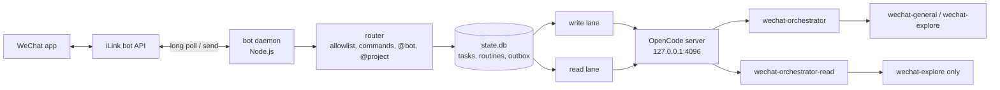

# wechat-opencode-bot

English | [中文](README_zh.md)

Send a WeChat message from your phone, get it run as a task on your local OpenCode server, and get the result back in the chat.

## Architecture



### Components

| Component | Code | Role |
|---|---|---|
| WeChat client | `src/wechat/` | iLink long polling, sending, CDN media, account credentials |
| Daemon | `src/main.ts`, `src/lifecycle.ts` | Wires everything up; holds `daemon.lock` so only one instance runs |
| Commands | `src/commands/` | `/status`, `/tasks`, `/routine`, … |
| Routing | `src/bots.ts`, `src/projects.ts`, `src/aliases.ts` | Picks the bot and the project directory for a message |
| Task queue | `src/tasks/` | SQLite schema and migrations, queue, lanes |
| Orchestrator | `src/orchestrator.ts` | Builds the prompt, runs the task, parses output, sends progress |
| OpenCode client | `src/opencode/provider.ts` | OpenCode HTTP API, watchdog, error classification |
| Model routing | `src/model-routing.ts` | Cross-gateway fallback and per-gateway breaker |
| Delivery | `src/notify.ts` | 2048-char chunks, outbox with backoff retries |
| Ops | `src/routines.ts`, `src/retention.ts`, `src/backup.ts`, `src/alerts.ts` | Scheduled tasks, session cleanup, daily backup, failure alerts |
| Agents | `config/agents/*.md` | Prompts and permissions of the four OpenCode agents |

The bot does not fork or patch OpenCode. It only calls the OpenCode HTTP API, so model quality, tools, MCP, skills and context limits all come from OpenCode and its config.

### Task lifecycle

1. A message from a user in `WECHAT_ALLOWED_IDS` arrives. Commands run at once; anything else becomes a task.
2. The task goes into `state.db` and waits in its lane. The reply says where it is: `⏳ 已排队：任务 #N（前面还有 X 个任务）`.
3. The bot opens a **new** OpenCode session in the project directory. Sessions are never reused.
4. The prompt carries the context: the last 8 tasks (reply excerpts for the latest 2), the chat memory, the bot persona.
5. The bot waits for the session to go idle, sending up to 4 progress messages on long tasks.
6. It parses the output (memory facts, reply), splits it into 2048-char chunks and puts them in the outbox.

A task that waits more than 24 hours expires. A daemon restart stops the running task with a ⏹ notice; queued tasks still run.

### Routing

| Message | Goes to |
|---|---|
| `@research …` | The bot with that alias |
| `@myproj …` or a project alias (2+ chars) anywhere | That project's directory |
| `@research @myproj …` | Both, in either order |
| `@all` / `@everyone` | Default bot, up to 3 subagents at once, one merged reply |
| `继续…` / `接着…` / `再…` (≤ 32 chars, within 2 h) | Same bot and project as the last task |
| `新话题：…` | No follow-up; `@base` runs in the base workspace |

The session opens at the project root, so the project's own `AGENTS.md` and `opencode.json` load natively and take precedence over the injected memory. The bot is never guessed from the text.

### Concurrency lanes

- Each WeChat account has one **write lane** and one **read lane**; each runs one task at a time.
- Tasks for read-only bots (such as `research`) use the read lane and run on `wechat-orchestrator-read`, which can only start `wechat-explore`.
- Read-only is an agent permission rule, not a sandbox.

### Model routing and resilience

- Default model: `oneapi/DeepSeek-V4.1-Flash`; `/model` switches it for all bots.
- Gateway errors (5xx, 429, timeout, no first response, stall) get **one** retry on another gateway (`OPENCODE_FALLBACK_MODEL` or the built-in chain). Auth, 4xx and permission denials are not retried.
- Three upstream failures in a row open that gateway's breaker for 10 minutes, doubling up to 1 hour. Meanwhile new tasks start on the fallback.
- Subagents without a `model:` inherit the parent's model, so a fallback moves the whole task tree.
- Three failed tasks in 30 minutes send one alert to WeChat.

### State and retention

| Data | Where | Kept |
|---|---|---|
| Tasks, routines, chat settings, outbox | `state.db` (SQLite, WAL) | Backed up daily |
| OpenCode sessions | OpenCode server | Deleted through the API after 7 days; newest 300 always kept |
| Memory | `memory/<account>/MEMORY.md`, `memory/<account>/bots/<id>.md` | 16 KB cap per file, 8 KB per prompt |
| Images | `attachments/` | 24 hours |

Schema changes only add columns and tables, so an older release can read a newer `state.db`.

### Permissions

OpenCode permission requests go to WeChat as `🔐 任务 #N（bot）请求权限：…`. Reply `y` / `n`; no reply in 120 s denies. Requests from both lanes queue per account, oldest answered first; a fourth waiting request is denied at once.

| Mode | Behavior |
|---|---|
| `default` | Ask in WeChat |
| `acceptEdits` | File edits auto-approved; the rest asked |
| `plan` | Deny everything |
| `auto` | Approve everything (dangerous) |

With `auto`, a WeChat account becomes a remote shell. Keep the allowlist tight and switch to `plan` when idle.

### Repo layout

```
src/            daemon, routing, orchestrator, queue, OpenCode and WeChat clients
src/tests/      node:test suites (fake OpenCode server)
config/agents/  OpenCode agent prompts
config/launchd/ launchd jobs for the bot and the OpenCode server
scripts/        release, deploy, rollback, healthcheck, install-agents, install-launchd
docs/DEPLOY.md  release, deploy, rollback, migration
```

## Usage

### Requirements

- Node.js 22.13+ (`node:sqlite`); CI uses Node 26.
- [OpenCode](https://opencode.ai) running `opencode serve` on `127.0.0.1:4096`.
- A personal WeChat account to bind by QR code.
- macOS for the always-on launchd setup; the bot itself is plain Node.js.

### Setup

```bash
git clone <repo-url> wechat-opencode-bot
cd wechat-opencode-bot
npm ci
npm run build
scripts/install-agents.sh --apply   # link the four agents into OpenCode (this checkout, or current/ after a deploy)
npm run setup                        # scan the QR code, then choose the working directory
```

Put settings in `~/.wechat-opencode-bot/env` (mode 600). The bot loads it at startup and the launchd wrappers source it. After a release deploy, rerun `install-agents.sh` so the links follow `current/` and each release ships its own prompts.

### Run

| Goal | Command |
|---|---|
| Try one task without WeChat | `node dist/main.js --simulate "列出工作目录"` |
| Run in the foreground | `node dist/main.js --daemon` |
| Print status / recent tasks | `node dist/main.js --status` / `--tasks 10` |
| Push a message to WeChat | `node dist/main.js --notify "text"` |
| Always on (launchd), release, rollback | See [docs/DEPLOY.md](docs/DEPLOY.md) |

### Commands

| Command | What it does |
|---|---|
| `/status` | State and health: lanes, queue, model, permission mode, 24 h outcomes, breakers, outbox, token age |
| `/tasks [n]` | Last n tasks (default 5, max 20) |
| `/stop [all]` | Stop the running task; `all` also cancels the queue |
| `/routine [add\|rm\|on\|off\|run]` | Manage scheduled tasks |
| `/cwd [path]`, `/ls` | Show or switch the working directory, list it |
| `/projects`, `/bots` | List project and bot aliases |
| `/model [name\|default]`, `/models` | Show, switch or list models |
| `/permission [mode]` | Show or set the permission mode |
| `/help`, `/version` | Help, version |

### Addressing examples

```
@eng 修一下登录页的报错
@research @myproj 看下发布流程
继续，把测试也补上
新话题：查一下今天的天气
```

Bots live in `~/.wechat-opencode-bot/bots.json` (default roster: `chief`, `research`, `eng`, `ops`). Projects live in `projects.json`, generated from the working directory's child directories.

### Routines

```
/routine add 早报 daily09:00 汇总昨天的工作
/routine add 巡检 every30m 检查服务健康
```

`dailyHH:MM` uses Asia/Shanghai; `everyNm` / `everyNh` range from 5 minutes to 24 hours. A routine never overlaps itself and does not make up runs missed while the bot was down.

### Environment

| Variable | Default | Meaning |
|---|---|---|
| `OPENCODE_URL` | `http://127.0.0.1:4096` | OpenCode server |
| `OPENCODE_SERVER_PASSWORD` | empty | Basic auth password for user `opencode` |
| `WECHAT_ALLOWED_IDS` | the bound account | Allowed WeChat user ids, comma-separated |
| `OPENCODE_DEFAULT_MODEL` | `oneapi/DeepSeek-V4.1-Flash` | Primary model assumed for routing |
| `OPENCODE_FALLBACK_MODEL` | built-in cross-gateway chain | Model for the one retry |
| `OPENCODE_FIRST_RESPONSE_TIMEOUT_MS` / `OPENCODE_STALL_TIMEOUT_MS` | `120000` / `180000` | Watchdog limits |
| `OWB_BREAKER_THRESHOLD` / `OWB_BREAKER_COOLDOWN_MS` | `3` / `600000` | Gateway breaker |
| `OWB_FAILURE_ALERT_COUNT` / `_WINDOW_MS` / `_COOLDOWN_MS` | `3` / `1800000` / `1800000` | Failure alerts |
| `OWB_SESSION_TTL_DAYS` / `OWB_SESSION_KEEP` | `7` / `300` | Session retention |
| `OWB_LOG_LEVEL` | `info` | Log level: `debug`, `info`, `warn` or `error` |
| `OWB_DATA_DIR` | `~/.wechat-opencode-bot` | Data directory (`accounts/`, `config.env`, `logs/` stay in the default) |

### Troubleshooting

| Symptom | Check |
|---|---|
| No reply at all | `node dist/main.js --status`; logs in `~/.wechat-opencode-bot/logs/` |
| `already running (pid N)` | Another daemon holds `daemon.lock`; stop it first |
| Routine or `--notify` result never arrives | WeChat needs a recent message token; send any message and the outbox flushes |
| Tasks fail with auth errors | Check `OPENCODE_SERVER_PASSWORD` matches the server |
| Every task uses the fallback model | A breaker is open; `/status` shows which gateway and when it retries |
| New agent not found | Re-run `scripts/install-agents.sh --apply`, then reload the server: `opencode reload --server http://127.0.0.1:4096` |

## License

MIT. Based on [zsxink/wechat-opencode-bot](https://github.com/zsxink/wechat-opencode-bot).
