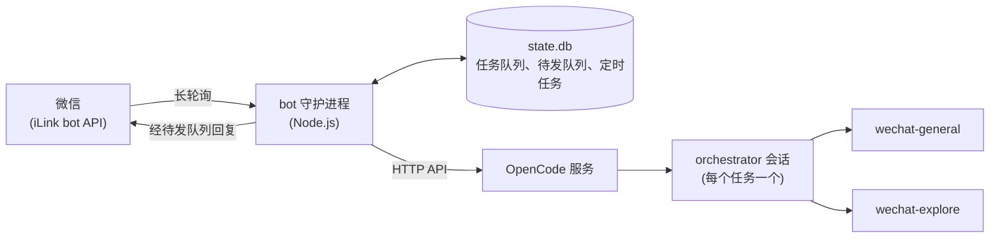

# wechat-opencode-bot

[English](README.md) | 中文

连接微信和 [OpenCode](https://opencode.ai) 的桥接程序。你发给 bot 的每条消息都会变成一个任务：本机的守护进程在本地 OpenCode 服务上新开一个会话执行它，再把结果发回聊天。支持文字、图片、语音、权限审批、定时任务，以及多个 bot 和多个项目，也能把图片和文件发回微信。

## Demo

```text
你：  @eng 修一下登录页的 500
Bot： 工程：已定位到 src/auth/session.ts：过期 token 没有清 cookie。
      改了 session.ts 和对应测试，npm test 通过。
你：  继续，补一个 e2e
Bot： 工程：补了 tests/e2e/login.spec.ts，本地通过。 /tasks 可以看本次用了多少 token。
```

以上为示意；bot 默认用中文回复，你用其他语言时它也会跟随。

## 架构



### 组件

| 组件 | 进程 / 运行时 | 作用 |
|---|---|---|
| 微信、iLink bot API | 腾讯的服务，`ilinkai.weixin.qq.com` | 通过长轮询把你的消息交给守护进程，并投递它的回复 |
| bot 守护进程 | `node dist/main.js --daemon`，Node.js | 分派消息、排队任务、通过 HTTP 驱动 OpenCode、发回结果 |
| OpenCode 服务 | `opencode serve`，监听 `127.0.0.1:4096` | 运行 agent 会话，调用模型 |
| orchestrator | primary agent `wechat-orchestrator` 和 `wechat-orchestrator-read` | 规划每个任务、分派工作、撰写回复 |
| 子 agent | `wechat-general`（能改文件）和 `wechat-explore`（不能） | 干活：读代码、跑命令、改文件 |
| `state.db` | SQLite（`node:sqlite`），位于数据目录 | 任务、待发队列、定时任务、每个聊天的设置 |
| launchd | 两个 macOS 用户级任务，可选 | 让服务和守护进程常驻（[docs/DEPLOY.md](docs/DEPLOY.md)） |

### 任务生命周期

1. 守护进程长轮询 iLink，忽略不在 `WECHAT_ALLOWED_IDS` 里的人。每条消息都会刷新这个聊天的 `context_token`，每次回复都要用到它。
2. `y`/`n` 回答正在等待的权限请求，`/` 命令直接得到回复。其余消息都变成任务：守护进程下载第一张图片，把文字分派给一个 bot 和一个项目，再把任务存进 `state.db`。前面还有任务时，它会回复 `⏳ 已排队：任务 #N（前面还有 X 个任务）` 和预计等待时间。
3. 通道的 worker 取出最早排队的任务，在项目根目录（没有项目时在聊天的工作目录）新开一个 OpenCode 会话。OpenCode 会加载该目录的 `AGENTS.md` 和 `opencode.json`，其中的规则优先于记忆和最近任务。
4. 会话从不复用，所以上下文由 prompt 携带：时间、附件、bot 的角色、项目、聊天记忆，以及最近 8 个任务（最近 2 个附回复摘录）。
5. orchestrator 把工作交给 `wechat-explore` 或 `wechat-general`，同时最多 3 个，每个任务最多 6 个。权限请求发到微信。orchestrator 在调用子 agent 前写的一句简短说明可以作为过程说明发到聊天；守护进程自己的进度通知（已运行时长、正在运行的工具、子 agent 数量）默认关闭。
6. orchestrator 的输出以 `<<<WECHAT_REPLY>>>`、`<<<WECHAT_MEMORY>>>`、`<<<WECHAT_SUMMARY>>>` 收尾，可选带 `<<<WECHAT_HANDOFF>>>` 和 `<<<WECHAT_FILES>>>` 段。守护进程保留回复、把最多 5 条带日期的事实写进记忆，保存摘要、交接、token 用量和文件路径，并在文字之后发送文件。
7. 2 小时内的下一个任务会收到上一个任务的 handoff（文件、命令、未完成项、下一步），所以“继续”不必只靠摘要重新摸索。结果加上 bot 的回复前缀后只进入待发队列一次，按 2048 字分段；失败显示 `⚠️ 任务 #N 失败：…`，重启中断显示 `⏹ 任务 #N 已中断…`。

### 路由

数据目录里的 `bots.json` 和 `projects.json` 定义 bot 和项目。两者在首次使用时生成，每条消息都会重新读取；生成之后由你自己维护。默认 bot 有 `chief`（默认，无前缀）、`research`（只读，`研究：`）、`eng`（`工程：`）和 `ops`（`Ops：`）。首次生成的 `projects.json` 为基础目录的每个子目录建一个条目，目录名就是它的别名之一；基础目录本身含 `.git`、`AGENTS.md` 或 `opencode.json` 时，再加一个 `base`。

| 消息 | bot | 项目 |
|---|---|---|
| `@research …`（开头是 bot 别名） | 该 bot | 从其余文字识别 |
| `@myproj …`（开头是项目别名） | 默认 bot，或紧随其后的 `@bot` | 该项目 |
| `@base …` | 默认 bot，或紧随其后的 `@bot` | 无，在聊天的工作目录运行 |
| `@all …`、`@everyone …` | 默认 bot，把各部分分给专长 bot，同时最多 3 个，最后合并成一条回复 | 从其余文字识别 |
| `新话题：…`（或 `换个话题`、`new topic`） | 从其余文字识别 | 从其余文字识别，不沿用上一个任务的 |
| 追问：`继续`、`接着`、`然后`、`再`、`还有`、`改一下`、`看一下`… | 沿用上一个任务的 | 沿用上一个任务的 |

- 没有 `@` 时由默认 bot 回答；bot 不会根据正文猜测。项目取正文任意位置出现的 2 字及以上别名（ASCII 别名须整词匹配），没有就不指定。只认 `projects.json`：正文里的路径不会被当作目录打开。与 bot 别名相同的项目别名会被丢弃。
- 追问不超过 32 字，以提示词开头，且在上一个任务 2 小时内发出；只有图片、没有文字也算追问。`@eng 继续` 沿用项目，换成 `eng`。

### 并发

- 每个账号有一条 `write` 通道和一条 `read` 通道，各自同时只跑一个任务。每条通道按到达顺序执行任务，任务从 `state.db` 原子领取。
- 只读 bot 指 `subagent` 为 `wechat-explore` 的非默认 bot，比如 `research`。它的任务走 read 通道，运行在 `wechat-orchestrator-read` 上；后者只能派 `wechat-explore`，所以能和写任务并行而不改文件。只读是 OpenCode 的权限规则，不是沙箱：`wechat-explore` 仍能执行 shell 命令。
- 其余任务（包括 `@all`）都走 write 通道。排队超过 24 小时的任务会过期。重启会中断正在运行的任务及其会话；排队中的任务照常执行。
- 发给同一个聊天的回复逐条发出，不论来自哪条通道。运行中任务的过程说明和进度通知（默认关闭）也要排队；任务结束时仍在等待的会被丢弃，所以它们不会晚于任务结果到达。

### 模型路由与容错

- 任务优先使用聊天里 `/model` 设置的模型；没有时使用 `bots.json` 中该 bot 的 `model`；都没有时使用 orchestrator 自己的 `model:`，路由假定它等于 `OPENCODE_DEFAULT_MODEL`。子 agent 没有 `model:` 行，沿用父会话的模型。
- `bots.json` 的每个 bot 可以选填 `model`（`provider/model[#variant]`）；`/model` 会覆盖所有 bot，`/model default` 恢复各 bot 自己的 model。
- 上游失败会在备用模型上重试一次：设置了 `OPENCODE_FALLBACK_MODEL` 就用它，否则用内置链路里第一个属于其他 provider（网关）的模型。上游失败包括 429 或额度不足、5xx 或过载、超时、连接错误、鉴权以外的 `provider.*` 错误，以及模型首次输出前沉默 120 秒、或两次进展之间沉默 180 秒。重试的 prompt 会提醒第一次尝试可能已改过文件；你只会看到最终结果。
- 不重试：鉴权、权限、4xx 和未知错误，本地服务的错误，以及单次尝试 30 分钟的上限。
- 每个网关有一个熔断器，状态只在内存里。连续 3 次上游失败会打开它：新任务直接用备用模型，聊天收到一条通知。10 分钟后下一个任务会再试这个网关；成功则关闭熔断，失败则等待时间翻倍，最长 1 小时。另外，30 分钟内 3 个任务失败会发一条 `🚨` 告警，之后 30 分钟内不再发。
- 过程说明：orchestrator 在调用子 agent 前写的那句话，会在该步骤的响应完成后加上 bot 的回复前缀发到聊天。每个任务最多 3 条（含重试），每条截断到 800 字；含分段标记或工具调用标记的文字、以及重试时重复的文字不会发送。它尽力而为：不进待发队列，也从不重试。最终回复只经待发队列发送一次。
- 进度通知属于诊断信息，默认关闭。设置 `OWB_PROGRESS_ENABLED=true` 后，任务运行 20 秒时发 `⏳ 任务 #N 运行中…`，附已运行时长、正在运行的工具和已派出的子 agent 数；之后在派出新子 agent 时或每 5 分钟再发，间隔至少 90 秒，每个任务最多 4 条。即使开启，`OWB_PROGRESS_MAX=0` 也会关掉它们。
- 每个结果在发送前先存入待发队列（`pending_notices`），按从旧到新的顺序发出。发送失败后依次等待 30 秒、2 分钟、10 分钟、1 小时，等待结束后在你的下一条消息或某个任务结束时重试。

### 状态与保留

除非写了完整路径，下列路径都在数据目录（`OWB_DATA_DIR`，默认 `~/.wechat-opencode-bot`）下。

| 内容 | 位置 | 保留 |
|---|---|---|
| 任务、待发队列、定时任务、每个聊天的设置 | `state.db`：`tasks`、`task_sessions`、`pending_notices`、`routines`、`users` | 打开时执行迁移（`PRAGMA user_version`，只做增量变更） |
| `state.db` 的备份 | `backups/state-<time>.db` | 启动时若最新备份已超过一天就新建一份；保留 7 份 |
| OpenCode 会话 | OpenCode 服务 | 任务结束 7 天后经它的 API 删除，始终保留最新 300 个；启动时和每天检查一次 |
| 记忆 | `memory/<account>/MEMORY.md`（共享，由默认 bot 写入）、`memory/<account>/bots/<id>.md` | 每个任务最多 5 条、每条 300 字；每个文件最多向 prompt 注入 8 KB，上限 16 KB |
| 图片 | `attachments/<task>/` | 24 小时；图片任务之后 10 分钟内的文字任务会复用这些图片 |
| 日志 | `~/.wechat-opencode-bot/logs/` | 每天一个文件，保留 3 个 |

### 权限

OpenCode 请求审批时，守护进程按 `config.env` 里的模式处理。每次请求都会重新读取模式，所以 `/permission` 对正在运行的任务也生效：`default` 把每个请求发到微信，`acceptEdits` 自动批准编辑、其余发到微信，`plan` 全部拒绝，`auto` 全部批准（危险）。

- 请求会标明所属任务：`🔐 任务 #N（bot）请求权限：…`。回复 `y`（`yes`、`ok`、`是`、`允许`、`同意`）或 `n`（`no`、`否`、`拒绝`）。120 秒内没有回复即拒绝。
- 每个账号的请求排成一个队列，每次回答都给最早的那个。第 4 个等待中的请求会被直接拒绝。超时后 15 秒内发出的 `y`/`n` 不会用到下一个请求上。
- 哪些操作需要审批由你的 OpenCode 权限配置决定。`WECHAT_ALLOWED_IDS` 里的任何人都能通过 `wechat-general` 在本机执行命令，所以名单里只放你自己。

### 仓库结构

| 路径 | 内容 |
|---|---|
| `src/` | 守护进程：`main.ts`（CLI、收消息）、`orchestrator.ts`（prompt、执行、结果）、`opencode/`（HTTP 客户端、watchdog）、`tasks/`（`state.db`、通道）、`wechat/`（iLink 客户端）、`commands/`、`tests/` |
| `config/agents/` | 四个 agent 的提示词，见 [config/agents/README.md](config/agents/README.md) |
| `config/launchd/` | server、daemon、watchdog 三个 launchd 模板，分别经 `run-server.sh`、`run-bot.sh`、`scripts/watchdog.sh` 启动 |
| `scripts/` | `release.sh`、`deploy.sh`、`rollback.sh`、`healthcheck.sh`、`install-agents.sh`、`install-launchd.sh` |
| `docs/` | [DEPLOY.md](docs/DEPLOY.md) 和设计文档 |

## 使用

### 环境要求

- Node.js 26，即 CI 使用的版本（`node:sqlite` 至少需要 22.13）。只有 launchd 任务需要 macOS。
- OpenCode 2（`npm install -g @opencode/cli`，不是 OpenCode 1 的 `opencode-ai`），并为要用的模型配置好 provider。
- 一个用于扫码绑定的微信号；setup 会把 iLink bot token 存到 `~/.wechat-opencode-bot/accounts/`。

### 安装与设置

1. `git clone <repo> wechat-opencode-bot && cd wechat-opencode-bot && npm ci && npm run build`
2. `npm run setup`：用微信扫码，再输入基础目录（`config.env` 里的 `workingDirectory`）；项目和 `/cwd` 都必须在它里面。
3. 选择模型。提示词和默认值用的是你多半没有的 `oneapi*` provider：修改 `config/agents/wechat-orchestrator.md` 和 `wechat-orchestrator-read.md` 里的 `model:`，把 `OPENCODE_DEFAULT_MODEL` 设成同一个模型，把 `OPENCODE_FALLBACK_MODEL` 设成另一个 provider 上的模型。[docs/PROVIDERS.md](docs/PROVIDERS.md) 有 Anthropic、OpenAI、Ollama 和自建网关的示例。
4. 把这些和其他配置写进 `~/.wechat-opencode-bot/env`，然后 `chmod 600`。
5. `scripts/install-agents.sh --apply` 把 agent 提示词链接到 `~/.config/opencode/agents/`；不带 `--apply` 时只列出改动。然后用它打印的命令 reload OpenCode，或者重启服务。

`accounts/`、`config.env`（`workingDirectory`、`permissionMode`）和 `logs/` 始终在 `~/.wechat-opencode-bot/`；其余内容，包括 `env`、`bots.json` 和 `projects.json`，都在数据目录。

### 运行

| 命令 | 作用 |
|---|---|
| `node dist/main.js --daemon` | 前台运行 bot。它持有 `daemon.lock`，第二个实例会打印 `already running (pid N)` 并退出 |
| `node dist/main.js --simulate "列出工作目录"` | 像收到一条微信消息那样执行一个任务，并打印回复。需要服务已在运行，使用账号 `simulate`，所有权限请求一律拒绝 |
| `node dist/main.js --status` | 守护进程的 pid 和 `/status` 报告（不含熔断） |
| `node dist/main.js --tasks [n]` | 最近 n 个任务 |
| `node dist/main.js --notify "<text>"` | 给聊天发一条消息。退出码 2（`no_context_token`）或 3（`send_failed`）表示它留在待发队列里 |

在源码目录里，每次改动后都要先 `npm run build`，再使用这些命令。

常驻运行的 bot 改用 release。CI 构建每次推送到 `main` 的提交，把 `dist/` 和记录提交哈希的 `BUILD_COMMIT` 文件作为 artifact `wechat-opencode-bot-build-<commit>` 上传。`scripts/release.sh <tag> <artifact-dir>` 把已提交的 HEAD 和这个 artifact 的 `dist/` 打包，只在 `BUILD_COMMIT` 等于 HEAD 的哈希时才打包，不编译也不跑测试。artifact 要取自该提交推送到 `main` 后成功的那次 CI 运行：pull request 的运行构建的是 GitHub 临时生成的合并提交，所以 `release.sh` 会拒绝它的 artifact。`scripts/deploy.sh` 把 release 安装为 `releases/<tag>`，并让 `current` 符号链接指向它；launchd 经 `run-bot.sh` 运行 `node current/dist/main.js --daemon`。`run-bot.sh` 和 `run-server.sh` 会 `cd` 到写死的目录，先改好它们，再按 [docs/DEPLOY.md](docs/DEPLOY.md#release) 操作。部署之后重新执行 `scripts/install-agents.sh --apply`，让 agent 链接跟随 `current/`。

### 命令

| 命令 | 作用 |
|---|---|
| `/help` | 显示帮助 |
| `/status` | 工作目录、项目、bot、模型、权限模式、运行中和排队的任务、记忆；以及 24 小时结果、token 用量、已打开的熔断、待补发数量和消息令牌的时效 |
| `/tasks [n]` | 最近 n 个任务（默认 5 个，最多 20 个），有记录时附带 token 用量；达到 `OWB_TASK_WARN_TOKENS` 的任务标 ⚠️ |
| `/session <id\|标题>` | 直接读这台 OpenCode 上的会话：原样返回它最后一条助手文本（超过 20000 字截断）；标题匹配多个时列出最多 5 个 id |
| `/stop` | 停止两条通道里正在运行的任务，并拒绝等待中的权限请求；`/stop all` 同时取消队列 |
| `/cancel <编号>` | 取消一个排队中的任务 |
| `/steer [#编号] <内容>` | 给运行中的任务发一条修正；OpenCode 在下一个步骤采纳 |
| `/cwd [path]` | 查看或设置聊天的工作目录，须在基础目录内 |
| `/ls` | 列出工作目录（最多 100 项） |
| `/projects [add\|rm] …` | 列出项目，或 `add <id> [目录]` / `rm <id\|别名>` |
| `/bots` | 列出 bot：id、别名、回复前缀、model、是否默认 |
| `/model [model]` | 查看或设置之后任务的模型，覆盖所有 bot：`provider/model[#variant]` 或只写 id；`/model default` 恢复各 bot 自己的 model |
| `/models` | 列出服务上的模型 |
| `/doctor` | 自检：OpenCode、agent、消息令牌、待补发、数据库、熔断、定时任务和运行时长 |
| `/panic` | 停止并取消所有任务、拒绝等待中的审批、切到 `plan`、停用所有定时任务 |
| `/permission [mode]` | 查看或设置 `default`、`acceptEdits`、`plan` 或 `auto` |
| `/routine …` | 列出定时任务，或对某一个执行 `add`、`rm`、`on`、`off`、`run` |
| `/version`、`/v` | 显示版本 |

其他 `/word` 形式的输入会得到 `未知命令`；命令从不变成任务。

### 指定 bot 和项目

| 你发送 | 执行方式 |
|---|---|
| `@research @myproj 看下发布流程` | 由 `research` 在 read 通道执行，项目是 `myproj` |
| `@eng 修一下 myproj 的构建脚本` | 由 `eng` 执行，项目是 `myproj`，因为消息里提到了它 |
| `@base 列出所有仓库` | 由默认 bot 在聊天的工作目录执行 |
| `新话题：今天天气怎么样` | 由默认 bot 执行，不指定项目；不沿用上一个任务的 bot 和项目 |

### 定时任务

`/routine add 早报 daily09:00 汇总昨天的工作` 会在每天 09:00 把这段 prompt 作为普通任务排队。时间格式有 `dailyHH:MM`（Asia/Shanghai，固定 UTC+8）、`everyNm` 和 `everyNh`（5 分钟到 24 小时）。

- prompt 在添加时像普通消息一样分派，所以可以带 `@bot` 和 `@project`；之后两者固定不变。若项目后来被移动或移除，下一次任务会回退到基础工作区并记录一条警告。
- 同一个定时任务不会同时跑两个任务：到点时如果它的上一个任务还在排队或运行，这次就跳过。
- 停机期间到期的定时任务会补跑一次，之后按原计划执行；其余错过的执行直接丢弃。
- 结果经待发队列发送，所以没有较新的消息令牌时，会等你的下一条消息。

### 环境变量

每个 `node dist/main.js` 命令都会加载数据目录里的 `env`，环境里已有的变量优先。`OWB_DATA_DIR` 必须直接在环境里设置。数值型的 `OWB_*` 和 `*_TIMEOUT_MS` 变量取 `0` 或非数字时使用默认值；`OWB_PROGRESS_MAX` 例外，取 `0` 时不发任何进度通知。

| 变量 | 默认值 | 含义 |
|---|---|---|
| `OPENCODE_URL` | `http://127.0.0.1:4096` | OpenCode 服务地址 |
| `OPENCODE_PORT` | `4096` | 没有服务响应时，守护进程自行启动的服务所用端口 |
| `OPENCODE_SERVER_PASSWORD` | 空 | 服务密码，以用户 `opencode` 的 Basic auth 发送 |
| `WECHAT_ALLOWED_IDS` | 绑定的账号 | bot 接收消息的微信用户 id，逗号分隔 |
| `OPENCODE_DEFAULT_MODEL` | `oneapi/DeepSeek-V4.1-Flash` | 没有 `/model` 时路由假定的模型；与 orchestrator 的 `model:` 保持一致 |
| `OPENCODE_FALLBACK_MODEL` | 内置链路 | 那一次重试使用的模型，即使与主模型在同一个 provider 上 |
| `OPENCODE_FIRST_RESPONSE_TIMEOUT_MS`、`OPENCODE_STALL_TIMEOUT_MS` | `120000`、`180000` | 首次输出前、两次进展之间允许的沉默时长 |
| `OWB_BREAKER_THRESHOLD`、`OWB_BREAKER_COOLDOWN_MS` | `3`、`600000` | 打开熔断所需的连续上游失败次数，以及首次冷却时长 |
| `OWB_FAILURE_ALERT_COUNT`、`OWB_FAILURE_ALERT_WINDOW_MS`、`OWB_FAILURE_ALERT_COOLDOWN_MS` | `3`、`1800000`、`1800000` | 窗口内触发告警的失败任务数、窗口长度、告警后的静默时长 |
| `OWB_ALERT_WEBHOOK` | 空 | watchdog 的每条告警也以纯文本 POST 到这个 URL，例如 ntfy 主题或 Slack 代理 |
| `OWB_ALERT_PING_URL` | 空 | watchdog 每次运行结果健康时 GET 这个 URL，供外部的 dead-man's switch（如 healthchecks.io）在收不到 ping 时告警 |
| `OWB_SESSION_TTL_DAYS`、`OWB_SESSION_KEEP` | `7`、`300` | 会话保留：天数，以及最近多少个已完成任务保留它们的全部会话 |
| `OWB_PROGRESS_ENABLED` | 空 | 取 `true` 时开启诊断用的进度通知，其他值都不开启。过程说明不受它影响 |
| `OWB_PROGRESS_FIRST_MS`、`OWB_PROGRESS_MIN_GAP_MS`、`OWB_PROGRESS_EVERY_MS`、`OWB_PROGRESS_MAX` | `20000`、`90000`、`300000`、`4` | 进度通知（需 `OWB_PROGRESS_ENABLED=true`）：首条时间、最小间隔、常规间隔、每个任务的上限；`OWB_PROGRESS_MAX=0` 时一条都不发 |
| `OWB_TASK_WARN_TOKENS` | `500000` | 输入 token（含缓存）达到这个数的任务会记一条警告日志，并在 `/tasks` 里标 ⚠️ |
| `OWB_ASR_URL`、`OWB_ASR_MODEL`、`OWB_ASR_API_KEY` | 空、`whisper-1`、空 | 语音没有微信自带转写时使用的 OpenAI 兼容转写接口；SILK 会先解码为 WAV |
| `OWB_DATA_DIR` | `~/.wechat-opencode-bot` | 数据目录 |
| `OWB_LOG_LEVEL` | `info` | `debug`、`info`、`warn` 或 `error` |

### 排障

| 现象 | 原因与处理 |
|---|---|
| `already running (pid N)` | 另一个守护进程持有 `daemon.lock`；`node dist/main.js --status` 会显示它的 pid、启动时间和入口。进程已不存在、或早于上次开机的锁会被接管 |
| `OpenCode 未安装…` 或 `OpenCode 服务启动失败或超时…` | `OPENCODE_URL` 上没有服务响应，守护进程也没能在 120 秒内启动 `opencode serve`。检查 `PATH` 里有没有 `opencode`，以及 `OPENCODE_PORT` 和 `OPENCODE_SERVER_PASSWORD` |
| 结果不再送达；`/status` 显示 `📮 待补发` | 发送需要较新的 `context_token`。给 bot 随便发一条消息；待发队列过了退避时间就会重试 |
| 任务一开始就用备用模型；`/status` 的 `🧯 熔断` 列出了某个网关 | 该网关的熔断会保持打开，直到显示的剩余分钟数走完。`~/.wechat-opencode-bot/logs/` 里每条 `Task finished` 日志都有 `model`、`attempts`、`fallback` 和 `errorKind`；`OWB_LOG_LEVEL=debug` 会记录更多 |
| bot 在运行，但不再回复 | launchd 上的 watchdog（`scripts/watchdog.sh`）会在约 10 分钟内重启不再写心跳的守护进程，并把重启记在 `~/.wechat-opencode-bot/logs/watchdog.log`，见 [Watchdog](docs/DEPLOY.md#watchdog)。它发现不了微信会话过期：见下一行 |
| 守护进程输出 `⚠️ 微信会话已过期，请重新运行 setup 扫码绑定` | iLink 会话已过期。重新运行 `npm run setup` |

## License

MIT，见 [LICENSE](LICENSE)。基于 [zsxink/wechat-opencode-bot](https://github.com/zsxink/wechat-opencode-bot)。

更多：[贡献指南](CONTRIBUTING.md) · [安全](SECURITY.md) · [Provider 与模型](docs/PROVIDERS.md) · [部署与回滚](docs/DEPLOY.md)
